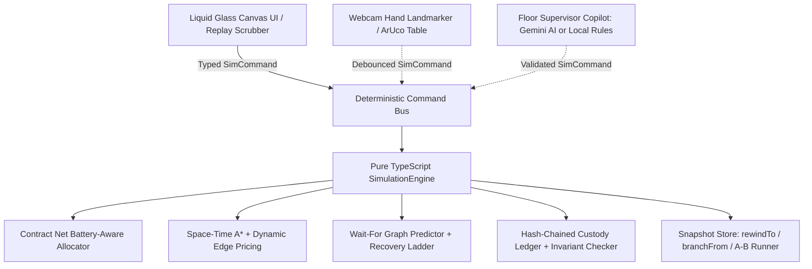

# Warehouse Robot Coordination Arena

> **"Others plan paths, we guarantee custody."**  
> Deterministic Multi-Agent Path Finding (MAPF), Tamper-Evident Package Custody Ledger, Predictive Deadlock Resolution, and Time-Travel Policy Arena.

## Safety & Scope Disclaimer
**This software is a discrete-time research and simulation tool.** It is **not** a real-world robot safety controller and is **not** a substitute for certified industrial safety sensors, hardware emergency stops, functional safety engineering (ISO 3691-4 / IEC 61508), or on-site risk assessment. Webcam hand tracking and ArUco marker features are optional interactive simulation inputs and must never be treated as verified human detection.

---

## Problem & Solution
Modern fulfillment warehouses run dozens of autonomous mobile robots (AMRs) through narrow 1-cell-wide aisles. Naive planners fail in three ways:
1. **Gridlock & Head-On Livelock**: Two or more robots enter single-lane corridors without reserving passing bays.
2. **Split-Brain Custody Bugs**: When a robot fails mid-route or loses wireless connectivity in an RF deadzone, naive retry logic can double-assign a package, drop cargo silently, or allow a stale carrier to commit a duplicate delivery.
3. **Opaque Decisions**: Operators cannot tell *why* a robot stalled, rejected a bid, or triggered a safety stop.

**Warehouse Robot Coordination Arena** solves all three in a pure, offline-capable deterministic TypeScript engine:
- **Space-Time A* with Vertex & Edge-Swap Reservations**: Guarantees zero vertex collisions and zero head-on edge swaps across rolling horizons.
- **Projected Wait-For Graph + Preemptive Backtrack**: Projects reservations 10 ticks ahead, detects cycles before gridlock forms, and routes the lowest-cost robot into a passing bay.
- **Hash-Chained Custody Ledger with Fencing Epochs**: Every package transitions atomically (`UNASSIGNED -> ASSIGNED -> PICKED -> DELIVERED`, or `STRANDED -> RESCUE`) guarded by monotonic fencing epochs and verified every tick.
- **Time-Travel & Counterfactual Branching**: Rewind to any tick, branch with a different scheduling policy, and compare live A/B KPIs side-by-side.

---

## Visual Walkthrough (GIF Placeholders)
- `docs/media/narrow-aisle-bay.gif` — Head-on corridor conflict resolved via projected wait-for cycle detection and recessed passing bay yield.
- `docs/media/custody-rescue.gif` — Mid-route carrier failure stranding a pod and dispatching an automated `URGENT` rescue robot with zero custody violations.
- `docs/media/timetravel-ab.gif` — Time-travel scrubber rewinding to tick `T` and branching into a side-by-side A/B policy comparison.

---

## One-Command Quickstart (100% Offline Capable)

```bash
npm install && npm run dev
```

Run the full verification test suite and fleet scaling benchmark:

```bash
npm test
npm run bench
npm run build
```

## System Architecture



## Algorithms Explained Simply
1. **Space-Time A*** (`src/engine/planner.ts`): Searches `(x, y, t)` states rather than 2D `(x, y)` cells. A reservation table blocks any `(x, y, t)` vertex held by a higher-priority robot and blocks `(u -> v, t)` whenever another robot traverses `(v -> u, t)`.
2. **Wait-For Graph Deadlock Prediction** (`src/engine/deadlock.ts`): Looks 10 ticks ahead into the reservation table. If robot A needs B's cell, B needs C's cell, and C needs A's cell, DFS detects the cycle early and backs the lowest-cost robot into a passing bay before anyone stops.
3. **Contract Net Protocol + Energy Reserve** (`src/engine/allocator.ts`): Idle robots bid on jobs using `Cost = alpha * ETA + beta * Congestion + gamma * BatteryRisk - PriorityBonus`. Bids are rejected unless `battery >= E_pickup + E_drop + E_charger + safetyReserve`.
4. **Custody Ledger Fencing Tokens** (`src/engine/ledger.ts`): Every package carries an integer `epoch`. Any ownership change requires an atomic Compare-and-Swap matching `(state, owner, epoch)`. A disconnected or recovered robot holding an old epoch is rejected automatically.

## Honest Related Work & Limitations
- **What Industry & Academia Already Do**: Production systems such as Amazon Robotics (Kiva), GreyOrange, and academic MAPF solvers (CBS / Conflict-Based Search, PIBT / Priority Inheritance with Backtracking, and RHCR / Rolling-Horizon Collision Resolution) solve large-scale warehouse routing using variants of windowed reservation tables and auction task allocation. This project adapts RHCR-style space-time A* with an explicit per-package fencing-token custody state machine and browser-native time-travel branching.
- **Honest Simulator Limitations**:
  - **Discrete Grid & Simplified Kinematics**: Robots move on a 2D orthogonal grid with simplified scalar velocity, friction, and payload multipliers rather than continuous differential-drive or Ackermann dynamics.
  - **Centralized Coordinator**: Planning and reservation arbitration run in a centralized deterministic loop rather than peer-to-peer V2V consensus.
  - **Simplified Battery & RF Models**: Battery drain is linear in distance and payload mass; `DEADZONE` cells model telemetry loss via a discrete buffered trajectory and 2-cell reservation halo rather than full RF propagation physics.
  - **Simulated Calibration**: The profile calibration workflow fits simplified linear/piecewise parameters against observed travel ticks and battery deltas; it does not guarantee physical hardware fidelity.
